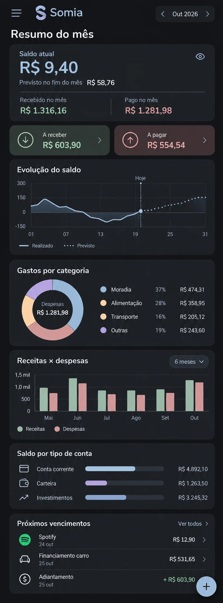

# Somia — nova apresentação do Resumo

Proposta visual aprovada em 13/10/2026. Implementação na linha v0.3.0-alpha.

A imagem é uma referência visual, com dados ilustrativos. Valores, datas, proporções e categorias do aplicativo sempre vêm do banco real; não reproduzir os dados fictícios do desenho.

## Objetivo e organização

Reduzir a distância entre o topo e as análises, usando grafite, azul acinzentado e tons pastéis. Manter menu lateral, mês ao lado da marca no Android e botão flutuante de lançamento.

1. Um cartão com saldo atual/efetivado/previsto conforme período, previsão no fechamento, recebido e pago, e resultado mensal separado do saldo.
2. A receber e a pagar compactos, com acesso às listas existentes.
3. Evolução diária conforme a referência adicional: grade discreta, escala automática incluindo zero, área azul suave, linha azul contínua até hoje e continuação azul pontilhada somente no futuro. Marcador vertical tracejado e rótulo Hoje no mês atual. Meses passados mostram realizado; futuros mostram previsto. Tocar/arrastar revela valores sem texto permanente sobre o gráfico. Pendências históricas continuam disponíveis na consulta; previsões futuras mantêm o saldo cumulativo original, inclusive atrasados, sem rebase artificial.
4. Gastos por categoria em rosca. Mostrar até cinco grupos; acima disso, quatro maiores mais Outras. Legenda sempre com nome, valor e percentual.
5. Receitas e despesas mensais com barras e consulta já existente.
6. Saldo por tipo de conta, incluindo contas excluídas do saldo principal. Valores negativos destacados e barras proporcionais à magnitude, sem apresentar saldo negativo como positivo. Moedas separadas.
7. Três próximos vencimentos; Ver todos expande a lista, Ver menos recolhe. Descrição completa no detalhe. Ações Abrir/Efetivar preservadas.
8. Detalhes por conta e últimos cadastrados continuam acessíveis abaixo.

No Windows, evolução e categorias ficam lado a lado quando há largura; histórico e tipos de conta em uma segunda linha. Android usa uma coluna. Texto ampliado empilha elementos.

## Escopo e regras

- Paleta local ao dashboard: fundo #141518, cartões #202226, azul #A5BCD0, receitas #A8C5B0, despesas #D6A3A3, lavanda #B8B3D9 e areia #D8C49E.
- Não modificar cálculos, efetivação, vencimentos, pagamentos de faturas, contas incluídas ou conversão de moedas nesta revisão visual.
- Ajuda sobre previsão disponível por tooltip; detalhamento de saldo preservado ao tocar no cartão.
- A primeira implementação mantém o histórico de seis meses existente. Alternância 6/12 meses, personalização dos blocos e ocultação global de valores ficam para evolução própria; o ícone de olho do conceito não é incluído como controle sem função.
- A cor da legenda deve coincidir com o respectivo segmento, corrigindo a inconsistência ilustrativa do conceito.

## Validação

- Testes existentes de layout responsivo: 320 px com fonte 2x, 360/390/520 px e desktop.
- Verificar a nova ordem, navegação mensal, abertura de detalhes, contas excluídas e consulta por gesto.
- Revisar previews Android/desktop geradas pela CI.
- Validar no aparelho: rolagem vertical versus arraste horizontal do gráfico, efetivação, expansão de vencimentos e legibilidade.

Sem migração do banco de dados.

## Estado da entrega

Issue #81 e PR #82 permanecem abertas para validação no aparelho. Base: `bf0d32a`, última integração disponível em `v0.3.0-alpha` usada nesta revisão. A primeira entrega gerou o APK assinado build 340. O refinamento do gráfico (`97f718b`) passou por formatação, análise estática, testes do dashboard e suíte completa Linux, com prévias geradas pela CI. Os cálculos financeiros e o esquema do banco permanecem inalterados. Esta revisão ainda não foi integrada à alpha.

## Refinamento do gráfico — referência adicional

Legenda com amostras reais de linha e pontos, rótulos de dia com dois dígitos e eixo financeiro em unidades da moeda. Pontos espaçados por distância ao longo da curva, inclusive em quedas acentuadas. Sem suavização que altere extremos dos saldos. Datas, escala e formato da curva dependem dos dados; os números ilustrativos da referência não são fixados no app. Consulta acessível por leitor de tela e teste de meses passados/futuros, saldo zero, negativo e ponto único.

## Saldo por tipo de conta — referência adicional

Ícone de cartão, carteira e tendência à esquerda; nome, barra arredondada e valor na mesma linha, com colunas alinhadas. Ordem estável: Conta corrente, Carteira, Investimentos, Poupança e Outras (apenas tipos existentes). Azul claro, lavanda e azul suave nos três primeiros tipos. Os comprimentos usam uma escala comum com folga de 50% sobre a maior magnitude, preservando proporções reais. Valores negativos mantêm sinal e cor vermelha. Em telas muito estreitas ou com texto ampliado, a barra vai abaixo do nome/valor para preservar legibilidade. Contas excluídas do saldo principal continuam incluídas neste detalhamento e moedas continuam separadas.
